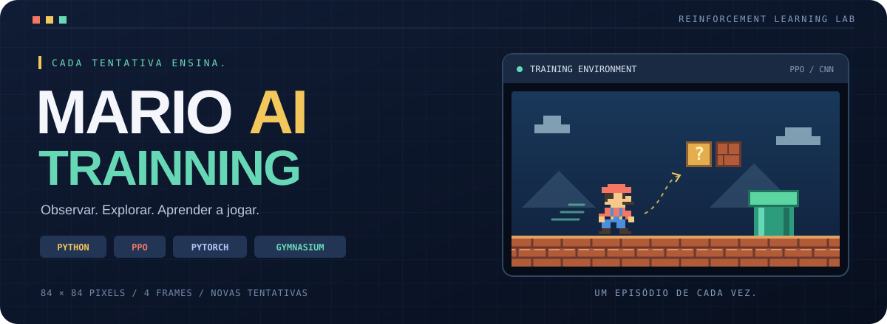
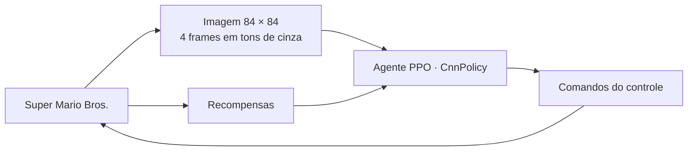

<div align="center">



# Mario AI Trainning

**Um laboratório de aprendizado por reforço para ensinar o Mario a jogar.**

Python · PPO · PyTorch · Gymnasium · Stable Baselines3

[Instalação](#instalação) · [Treinamento](#treinamento) · [Reprodução](#reprodução) · [Testes](#testes)

</div>

---

O **Mario AI Trainning** conecta o Super Mario Bros. a um agente de inteligência artificial. Durante o treinamento, o agente observa o jogo, experimenta comandos e usa as recompensas recebidas para ajustar suas decisões.

Você pode acompanhar as tentativas na janela do jogo, continuar um treinamento salvo e reproduzir o modelo para avaliar seu comportamento.

## O que o projeto oferece

- **Treinamento com PPO:** uma rede convolucional (`CnnPolicy`) processa as imagens do jogo.
- **Acompanhamento visual:** opção de mostrar o Mario enquanto ele aprende.
- **Progresso salvo:** salvamento periódico, ao concluir e ao interromper com **Ctrl+C**.
- **Continuação automática:** o treinamento retoma o `mario_ppo.zip` existente.
- **Reinício por inatividade:** o episódio termina após 3 segundos de jogo sem deslocamento horizontal.
- **Diagnóstico sem janela:** execução com semente e registro de ações e posição no console.

## Instalação

O ambiente utilizado no desenvolvimento é **Windows com Python 3.11**. Tenha o **Git** e o **Python** instalados e abra o PowerShell na pasta onde deseja baixar o projeto.

### 1. Clone o repositório

```powershell
git clone https://github.com/sostenesdev/mario-ai-train.git
cd mario-ai-train
```

A partir daqui, execute os comandos dentro da pasta `mario-ai-train`.

### 2. Crie e ative o ambiente virtual

```powershell
python -m venv venv
.\venv\Scripts\Activate.ps1
```

Se você já tem o ambiente `venv`, basta ativá-lo.

### 3. Instale as dependências

```powershell
python -m pip install -r requirements.txt
```

Os exemplos seguintes consideram o ambiente virtual ativado. Você também pode chamar `.\venv\Scripts\python.exe` diretamente no lugar de `python`.

## Treinamento

### Aprender com a janela do jogo aberta

```powershell
python train.py --steps 100000 --render
```

### Aprender sem abrir a janela

```powershell
python train.py --steps 100000
```

O treinamento usa a **CPU**. Se houver um `mario_ppo.zip` na pasta do projeto, o agente continua daquele ponto; caso contrário, cria um modelo novo.

| Opção | Para que serve | Padrão |
| --- | --- | --- |
| `--steps` | Quantos passos adicionais de treinamento executar. | `100000` |
| `--save-every` | Intervalo entre salvamentos, em passos. | `10000` |
| `--render` | Mostra a janela do jogo durante o aprendizado. | Desativado |

Para salvar com mais frequência:

```powershell
python train.py --steps 100000 --save-every 5000 --render
```

**Ctrl+C** interrompe o treinamento e salva o progresso. O mesmo arquivo `mario_ppo.zip` é atualizado nos salvamentos. O PPO coleta blocos de 512 passos, então o total pode ultrapassar ligeiramente o valor solicitado.

> Um treino curto valida o funcionamento do sistema. Aprender a jogar exige muitas tentativas: 100.000 passos não garantem concluir uma fase.

## Reprodução

Depois de gerar o modelo, execute:

```powershell
python main.py
```

A reprodução **não treina nem altera o modelo**. Por padrão, as ações são amostradas das probabilidades aprendidas pelo PPO, permitindo observar as diferentes tentativas do agente.

| Opção | Para que serve | Padrão |
| --- | --- | --- |
| `--steps` | Quantas decisões executar na reprodução. | `5000` |
| `--deterministic` | Escolhe sempre a ação mais provável. | Desativado |
| `--headless` | Executa sem abrir a janela do jogo. | Desativado |
| `--seed` | Define uma semente para repetir um teste. | Não definida |

Para avaliar a escolha mais provável de um modelo:

```powershell
python main.py --deterministic
```

Para executar um diagnóstico sem janela:

```powershell
python main.py --headless --steps 600 --seed 42
```

O console informa quantos passos de treino o modelo acumula, a posição horizontal do Mario, os botões executados e o encerramento por inatividade.

## Como o agente aprende

Durante o treinamento, o jogo fornece observações e recompensas para o agente ajustar suas decisões:



O treinamento e a reprodução usam o mesmo processamento das observações. A janela continua exibindo o jogo na resolução original.

### Regra dos 3 segundos

Quando a posição horizontal do Mario permanece igual por **180 frames a 60 FPS**, o episódio é encerrado e outro começa automaticamente.

- Qualquer deslocamento para a esquerda ou direita reinicia a contagem.
- Pular no mesmo lugar não reinicia a contagem.
- O limite considera **3 segundos de jogo**, independentemente da velocidade da CPU ou da renderização.
- A regra vale no treinamento e na reprodução, com ou sem janela.

## Estrutura do projeto

```text
.
├── docs/
│   └── assets/
│       └── readme-cover.svg        # Capa do projeto
├── tests/
│   └── test_inactivity_timeout.py  # Testes do limite de inatividade
├── .gitignore                     # Arquivos locais e resultados ignorados
├── main.py                        # Ambiente e reprodução do modelo
├── train.py                       # Treinamento e salvamento com PPO
├── wrappers.py                    # Compatibilidade e limite de inatividade
├── requirements.txt               # Dependências
└── README.md
```

O `mario_ppo.zip` é gerado localmente ao treinar e fica na mesma pasta de `main.py`. Modelos, ambientes virtuais, caches e resultados do treinamento são ignorados pelo Git.

## Testes

```powershell
python -B -m unittest discover -s tests -v
```

A suíte verifica o limite exato de inatividade, a retomada da contagem após movimento, a preservação dos encerramentos naturais e o reinício automático dos episódios no emulador.

## Dúvidas comuns

**O arquivo `mario_ppo.zip` não existe.**

Execute primeiro `python train.py --steps 100000`. A instalação das dependências não gera um modelo treinado.

**O Mario fica parado ou repete o mesmo comando.**

Um modelo pouco treinado pode repetir ações, especialmente com `--deterministic`. Continue o aprendizado com `python train.py --steps 100000 --render`. A regra de inatividade reinicia episódios sem movimento horizontal.

**Aparece um aviso de que o Gym foi descontinuado.**

O emulador ainda usa o Gym internamente. O projeto adapta essa API ao Gymnasium com Shimmy; esse aviso, por si só, não indica falha na execução.

**Mudei o código, mas um treino aberto continua com o comportamento anterior.**

Interrompa com **Ctrl+C** e execute o comando novamente para carregar a alteração.

## Créditos e referência

Baseado no projeto [Super Mario Bros for OpenAI Gym](https://github.com/Kautenja/gym-super-mario-bros), de **Christian Kauten (2018)**, que fornece o ambiente do jogo utilizado no treinamento.

### Citação BibTeX

```bibtex
@misc{gym-super-mario-bros,
  author = {Christian Kauten},
  howpublished = {GitHub},
  title = {{S}uper {M}ario {B}ros for {O}pen{AI} {G}ym},
  URL = {https://github.com/Kautenja/gym-super-mario-bros},
  year = {2018},
}
```
